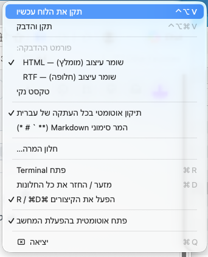

# FixHebrewPaste

אפליקציית שורת תפריטים קטנה ל-macOS שמתקנת את כיווניות הטקסט בלוח ההעתקה. היא מיועדת במיוחד לטקסט שהועתק מדפי אינטרנט ומשלב עברית ואנגלית, כדי שיודבק בכיוון הנכון — למשל ב-PowerPoint — בלי לאבד את העיצוב המקורי.



## שימוש

1. מפעילים את FixHebrewPaste. סמל `אA` יופיע בשורת התפריטים.
2. בתפריט הסמל מפעילים **תיקון אוטומטי בכל העתקה של עברית**.
3. מעתיקים טקסט כרגיל ומדביקים ביישום היעד. אפשר גם לתקן ולהדביק מיד באמצעות `⌃⌥⌘V`.

אפשרויות נוספות בתפריט:

- **תקן את הלוח עכשיו** — מתקן את הטקסט שכבר נמצא בלוח; לאחר מכן מדביקים כרגיל. קיצור: `⌃⌥V`.
- **פורמט ההדבקה** — בחירה בין HTML ששומר על העיצוב (מומלץ), RTF ששומר על העיצוב, או טקסט נקי.
- **המר סימוני Markdown** — ממיר סימוני Markdown נפוצים, כגון `**מודגש**` וכותרות, לעיצוב מתאים.
- **חלון המרה** — מאפשר להקליד או להדביק טקסט ידנית ולהעתיק ללוח את הגרסה המתוקנת.
- **OCR: תמונה בלוח ← טקסט רגיל** — מזהה את הטקסט (עברית ואנגלית) בתמונה או בצילום מסך שבלוח, ומחליף אותה בטקסט רגיל שאפשר להדביק. עובד גם על קובץ תמונה שהועתק מ-Finder. קיצור: `⌃⌥O`. הזיהוי נעשה מקומית (Apple Vision), והתמונה לא נשלחת לשום מקום.
- **אודות** — מספר הגרסה, רשימת הקיצורים וקישור למאגר.

## עדכונים

האפליקציה בודקת פעם ביום אם יצאה גרסה חדשה בעמוד [Releases](https://github.com/udiweinstein/FixHebrewPaste/releases). כשיש גרסה חדשה מופיעה הודעה, נקודה ליד הסמל (`אA•`) ושורה בראש התפריט עם קישור להורדה. אפשר לבדוק ידנית דרך **בדוק אם יש גרסה חדשה…**, ולכבות את הבדיקה האוטומטית בתפריט. הגרסה המותקנת מופיעה ב**אודות**.

אפשרות נוספת בתפריט: **פתח אוטומטית בהפעלת המחשב** (macOS 13 ומעלה, כשהאפליקציה בתיקיית Applications).

## התקנה

1. מורידים את `FixHebrewPaste.zip` מהגרסה האחרונה בעמוד [Releases](https://github.com/udiweinstein/FixHebrewPaste/releases/latest).
2. פותחים את הקובץ וגוררים את `FixHebrewPaste.app` לתיקיית **Applications**.
3. בפתיחה הראשונה macOS יחסום את האפליקציה, כי היא לא חתומה אצל Apple. פותחים **System Settings ← Privacy & Security** ולוחצים **Open Anyway**.
   לחלופין, ב-Terminal:
   ```sh
   xattr -dr com.apple.quarantine /Applications/FixHebrewPaste.app
   ```

נדרשת macOS 11 ומעלה. האפליקציה עובדת גם על Apple Silicon וגם על Intel.

### בנייה מקוד המקור

נדרשים Xcode Command Line Tools:

```sh
xcode-select --install
git clone https://github.com/udiweinstein/FixHebrewPaste.git
cd FixHebrewPaste
./build.sh
open FixHebrewPaste.app
```

### פרסום גרסה חדשה

הבנייה וה-Release נעשים אוטומטית ב-GitHub Actions: משנים את המספר בקובץ `VERSION` (למשל `1.3.0`), מעדכנים את `RELEASE_NOTES.md` ודוחפים ל-`main`. דחיפה לכל ענף אחר מריצה רק בנייה ובדיקות, בלי לפרסם. אפשר גם להפעיל ידנית בלשונית **Actions ← Build & Release ← Run workflow**.

## פרטיות

הטקסט והתמונות נקראים מלוח ההעתקה ומעובדים מקומית במחשב. האפליקציה אינה שולחת את תוכן הלוח לשום שרת. החיבור היחיד לרשת הוא בדיקת העדכונים: בקשה לעמוד הגרסאות של המאגר ב-GitHub, בלי שום מידע מהמחשב (אפשר לכבות אותה בתפריט).
